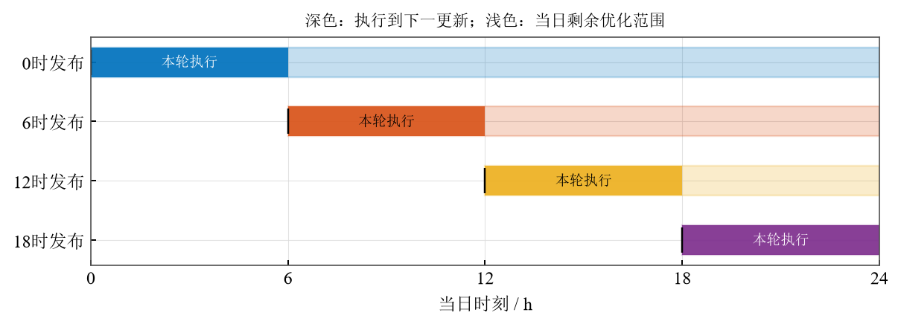

# 基于线性规划与滚动优化的微网电力调控策略

> 2026 高教社杯全国大学生数学建模竞赛（CUMCM）C 题 · **省级一等奖**
>
> 论文全文：[`main.pdf`](main.pdf) ｜ 提交材料存档：[`支撑材料_复现版.zip`](支撑材料_复现版.zip) ｜ AI 工具使用详情：[`AI工具使用详情.pdf`](AI工具使用详情.pdf)



## 项目简介

针对微网中光伏、储能与外购电协同的日内调度问题，在储能容量 1200--10800 kWh、
充放电功率上限 5000 kW、单程效率 0.9、调度间隔 10 min 等约束下，以购电费、合同
调整费与紧急补电费之和最小为目标，建立线性规划模型。四问共用同一套母线功率平衡、
储能状态递推、分段结算与 5 倍紧急购电口径，差别只在决策时刻可获得的信息。

| 问题 | 决策信息 | 建模与求解 |
|---|---|---|
| 问题 1 | 单日负荷、光伏与电价已知 | 确定性单日线性规划，HiGHS 求解 |
| 问题 2 | 负荷与光伏存在预测误差 | 两阶段情景线性规划 + 当前观测反馈执行 |
| 问题 3 | 0、6、12、18 时发布日内光伏预报 | 滚动优化 + 费用门控 |
| 问题 4 | 逐日波动价格，区分价格是否可见 | 预测价格主设定与价格已知对照回测 |

主要结果：

| 问题 | 结果 | 说明 |
|---|---:|---|
| 问题 1 | 35126.95 元 | 单日；较不配储能的 48052.05 元下降 26.90% |
| 问题 2 | 1386.39 万元 | 2 月 1 日至 12 月 31 日；较点预测基准节省 13.34% |
| 问题 3 | 1364.29 万元 | 四次日内更新较零时预报节省 36.75 万元（2.62%） |
| 问题 4-2 | 1462.14 万元 | 价格预测、日前计划 |
| 问题 4-3 | 1440.37 万元 | 价格预测、滚动优化 |

## 目录结构

```text
main.tex                       论文完整源码
main.pdf                       论文全文（实际提交版）
AI工具使用详情.pdf / .tex       AI 工具使用详情，对应论文参考文献前的“AI 工具使用声明”
README.md                      本说明
manifest.sha256                论文、代码、图表、结果等 202 个交付文件的 SHA-256 清单
支撑材料_复现版.zip             2026-09-13 实际提交的支撑材料原包（内含提交时的 README）

题目/                           赛题与原始附件，供复现使用
结果/                           五份规定结果工作簿
  result1.xlsx                  问题 1
  result2.xlsx                  问题 2
  result3.xlsx                  问题 3
  result4-2.xlsx                问题 4，沿用问题 2 的模型
  result4-3.xlsx                问题 4，沿用问题 3 的模型
  补充/                         当天价格完全已知的对照，非规定结果
    补充_价格已知_result4-2.xlsx
    补充_价格已知_result4-3.xlsx

code/                           源程序，论文附录 B 逐份列出
  model.py                      数据读取、预测、场景构造、稀疏线性规划、执行反馈
  run_experiments.py            四问主模型与全部对照实验
  export_results.py             生成结果/下的工作簿
  check_model.py                功率、SOC、费用与边界检查
  diagnostics.py                预报误差、场景配对与储能反馈诊断
  refinements.py                终端价值、费用选型与调整门控实验
  refinement_evidence.py        上述实验的表格与数值宏
  polish_presentation.py        分析表标题与描述统计
  paper_figures.py              论文图组与源数据核验
  review_experiments.py         风险权重、效率与库存诊断实验
  review_figures.py             诊断图组
  emergency_surface.py          紧急购电曲面图
  review_oracle_execution.py    当日完全预知执行的上界计算
  scientific_style.py           绘图公共样式
  verify_consistency.py         摘要、正文、工作簿与结果数组独立对账
  requirements.txt              依赖清单

results/                        计算结果、核验记录与模型中间数组（JSON／CSV／NPZ）
tables/                         论文引用的表格（LaTeX 源码）
figures/                        论文插图（PDF 与 PNG 预览）
```

## 结果文件口径

- `结果/` 五份工作簿为题面规定结果，文件名与工作表名均与附件 5 模板一致（时间标签
  的处理见论文附录 A.3）。
- `结果/补充/` 两份工作簿是“当天价格完全已知”的对照，**不得与规定工作簿混填**。
- 全年工作簿“计划购电量”“调整购电量”中的“全天购电费”均为当日实际总费用（含紧急
  购电费），两列重复展示同一笔费用，**不得相加**；逐日费用拆分见
  `results/daily_summary.csv`。

## 复现

环境：Python 3.12.14、NumPy 2.5.3、SciPy 1.18.1，另需 openpyxl、Matplotlib 与
XeLaTeX。本仓库已附 `题目/` 目录，可直接作为数据目录；`results/*.npz` 为模型运行的
中间数组，已随仓库存档，可跳过重算直接重绘图形。

```text
python -m pip install -r code/requirements.txt
python code/run_experiments.py --data 题目
python code/export_results.py --data 题目
python code/check_model.py --data 题目
python code/diagnostics.py --data 题目
python code/make_evidence.py
python code/refinements.py --data 题目
python code/refinement_evidence.py
python code/polish_presentation.py
python code/paper_figures.py
python code/review_experiments.py
python code/review_figures.py
python code/emergency_surface.py
python code/review_oracle_execution.py
python code/verify_consistency.py
xelatex -interaction=nonstopmode main.tex
xelatex -interaction=nonstopmode main.tex
xelatex -interaction=nonstopmode AI工具使用详情.tex
```

只重绘图形时，可直接使用 `results/` 中已存档的数组，运行相应绘图脚本即可；
`verify_consistency.py` 只读取既有结果，不产生新数据。

## 存档与核验

- `支撑材料_复现版.zip` 是 2026-09-13 实际提交的支撑材料原包，保持原样，不再修改。
- `manifest.sha256` 记录仓库内 202 个交付文件的 SHA-256，可用
  `sha256sum -c manifest.sha256` 校验。
- 论文提交版为 `main.pdf`（89 页），与提交压缩包同源；获省级一等奖。

## 协作记录

- 2026-09-11：git 推送权限测试通过（Yihan-HITSZ），可直接用 git 协作迭代论文。
- 2026-09-13：最终版“润色2.3”定稿并提交；2026-10-12 将省一等奖定稿归档至本仓库。
